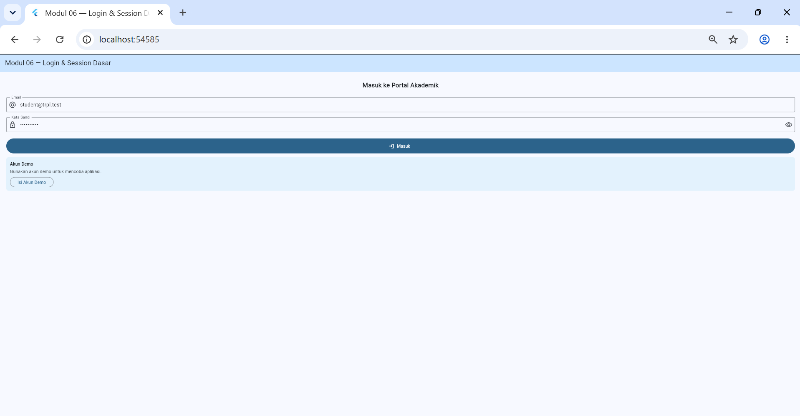
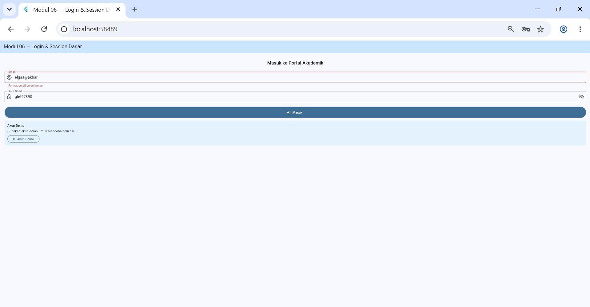
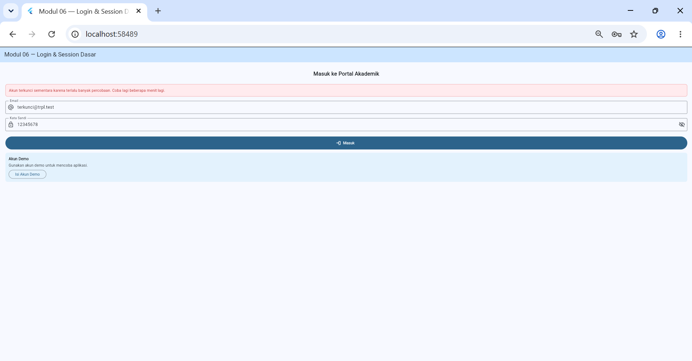
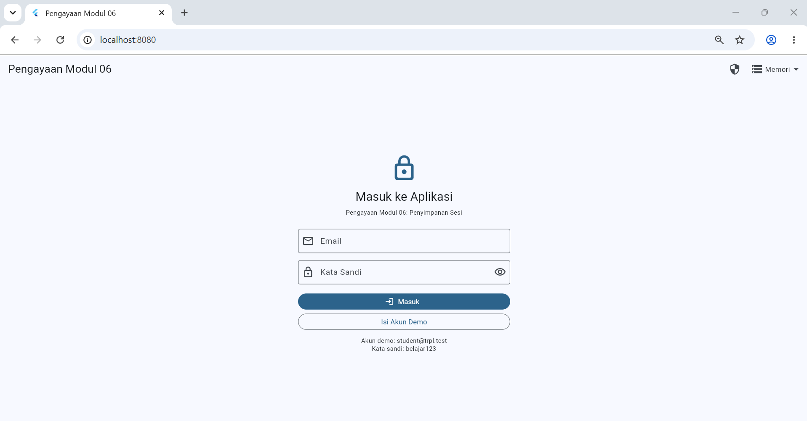
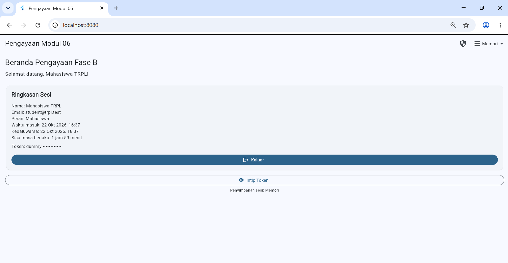
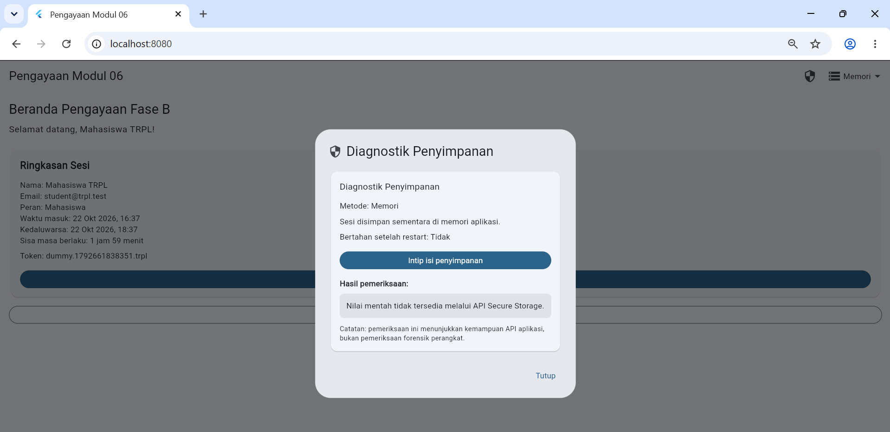
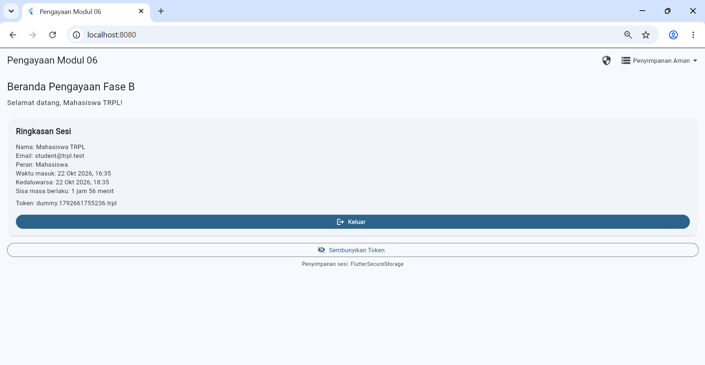

# Laporan Praktikum Modul 06: Login & Pengelolaan Sesi Aplikasi

- **Nama:** Elga Maulidia Akbari
- **NIM:** 362558302130
- **Kelas / Prodi:** 2E TRPL
- **Mata Kuliah:** Pemrograman Perangkat Bergerak (Semester 3)

---

## 1. Ringkasan Implementasi

Pada praktikum Modul 06 ini, saya membuat fitur login dan mencoba beberapa cara untuk menyimpan sesi pengguna di aplikasi Flutter.

Langkah-langkah yang saya kerjakan:

1. **Form Login dan Validasi (Fase A)**
   - Membuat tampilan login dengan tombol Isi Akun Demo.
   - Menambahkan validasi format email.
   - Menangani pesan kesalahan ketika akun terkunci atau server mengalami gangguan.
   - Menampilkan halaman beranda setelah login berhasil.

2. **Percobaan Penyimpanan Sesi (Fase B)**
   - **In-Memory:** Menyimpan sesi sementara di memori aplikasi.
   - **SharedPreferences (Prefs):** Menyimpan data sesi secara lokal.
   - **Penyimpanan Aman:** Mencoba penyimpanan sesi aman sesuai dukungan platform.
   - **Diagnostik Token:** Memeriksa status penyimpanan sesi dan token sesuai kemampuan aplikasi.

## 2. Bukti Tangkapan Layar (Running App)

### A. Alur Login dan Penanganan Error (Fase A)

| 1A. Form Login Kosong | 2A. Menggunakan Akun Demo |
|---|---|
|  |  |

| 3A. Format Email Salah | 4A. Pesan Akun Terkunci |
|---|---|
|  |  |

| 5A. Gangguan Server | 6A. Beranda Setelah Login |
|---|---|
|  |  |

### B. Percobaan Penyimpanan Sesi dan Diagnostik (Fase B)

#### 1. Penyimpanan Memori (In-Memory)

| 1B. Halaman Login Pengayaan | 2B. Beranda dengan Token Tersembunyi |
|---|---|
|  |  |

| 3B. Beranda dengan Token Ditampilkan | 4B. Diagnostik Penyimpanan Memori |
|---|---|
|  |  |

#### 2. Penyimpanan Preferences (SharedPreferences)

| 5B. Beranda Sesi Prefs | 6B. Diagnostik Penyimpanan Prefs |
|---|---|
|  |  |

#### 3. Penyimpanan Aman (Secure Storage)

| 7B. Beranda Sesi Aman | 8B. Diagnostik Secure Storage |
|---|---|
|  |  |

---

## 3. Kendala yang Dihadapi dan Solusinya

**Kendala 1: Kesalahan input dan gangguan server**

Solusi: Menambahkan validasi pada formulir login dan penanganan kesalahan agar pengguna mendapatkan informasi saat proses login gagal.

**Kendala 2: Sesi In-Memory hilang setelah aplikasi dimulai ulang**

Solusi: Mencoba SharedPreferences dan penyimpanan aman untuk mempelajari perbedaan penyimpanan sesi sementara dan persisten.

**Kendala 3: Token sensitif terlihat di layar**

Solusi: Mempelajari fitur sembunyikan dan tampilkan token jika didukung oleh implementasi aplikasi.

---

## 4. Jawaban Pertanyaan Refleksi

### 1. Apa pertanyaan baru yang muncul ketika sesi mulai disimpan secara persisten?

Ketika sesi disimpan, kita perlu memastikan apakah pengguna masih bisa login setelah aplikasi ditutup dan dibuka kembali. Kita juga perlu memeriksa apakah sesi yang sudah kedaluwarsa masih bisa digunakan.

### 2. Bagaimana tombol Back bisa menyebabkan kesimpulan yang salah tentang penyimpanan?

Tombol Back tidak selalu menutup aplikasi sepenuhnya. Jadi, kalau sesi masih ada setelah tombol Back ditekan, belum tentu sesi tersebut sudah tersimpan secara permanen.

### 3. Apakah pesan “Email atau kata sandi salah” merugikan pengguna?

Pesan ini memang tidak menjelaskan kesalahan secara detail. Namun, pesan tersebut lebih aman karena orang lain tidak bisa mengetahui apakah email yang dimasukkan sudah terdaftar atau belum.

### 4. Apa masalahnya jika SharedPreferences digunakan untuk menyimpan sesi?

SharedPreferences bisa digunakan untuk menyimpan data sederhana. Namun, untuk data penting seperti token login, Secure Storage lebih cocok karena memberikan perlindungan yang lebih baik.

### 5. Apakah token masih layak disimpan di perangkat yang sudah di-root atau dipantau?

Token masih bisa disimpan menggunakan Secure Storage karena lebih aman daripada penyimpanan biasa. Namun, jika perangkat sudah di-root atau dipantau, token tetap bisa berisiko diketahui orang lain. Karena itu, keamanan juga perlu diperhatikan dari sisi server.

---

## 5. Kesimpulan

Dari praktikum Modul 06, saya belajar cara login dan mengelola sesi pengguna di aplikasi Flutter. Saya juga belajar bahwa setiap metode penyimpanan memiliki kelebihan dan kekurangan. Oleh karena itu, metode penyimpanan harus dipilih sesuai kebutuhan agar data pengguna tetap aman.