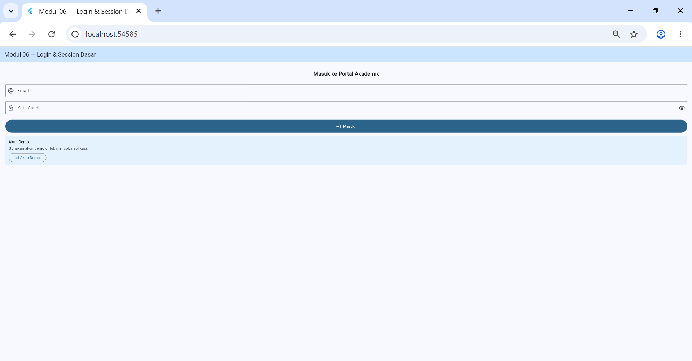
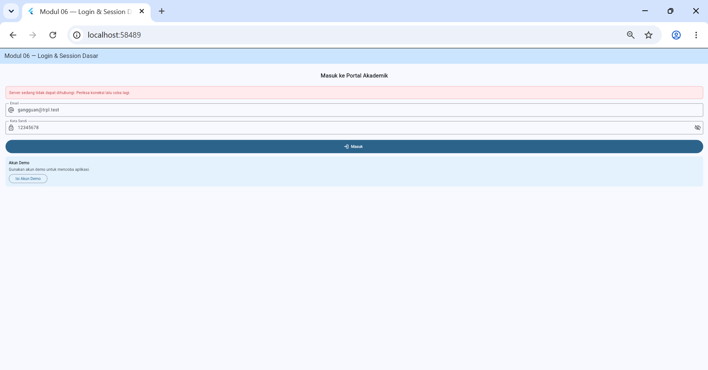
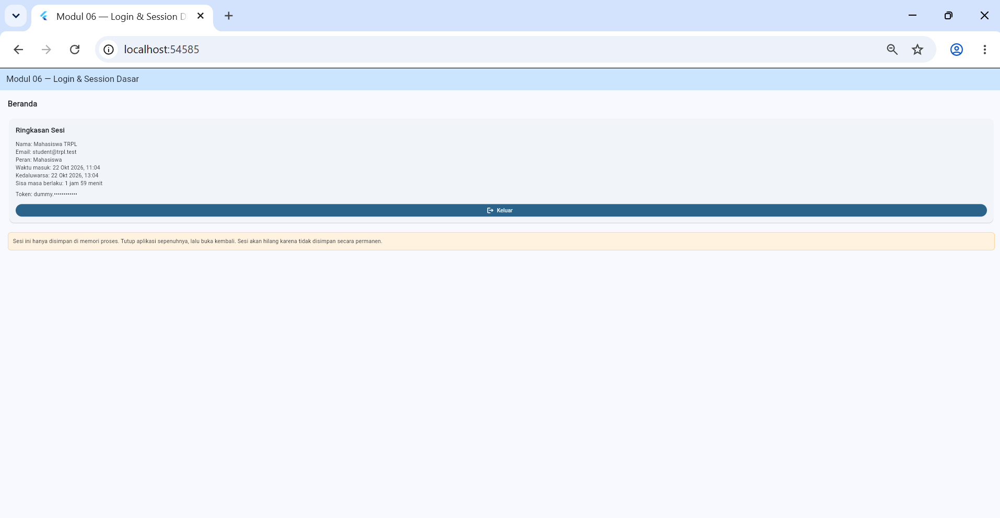
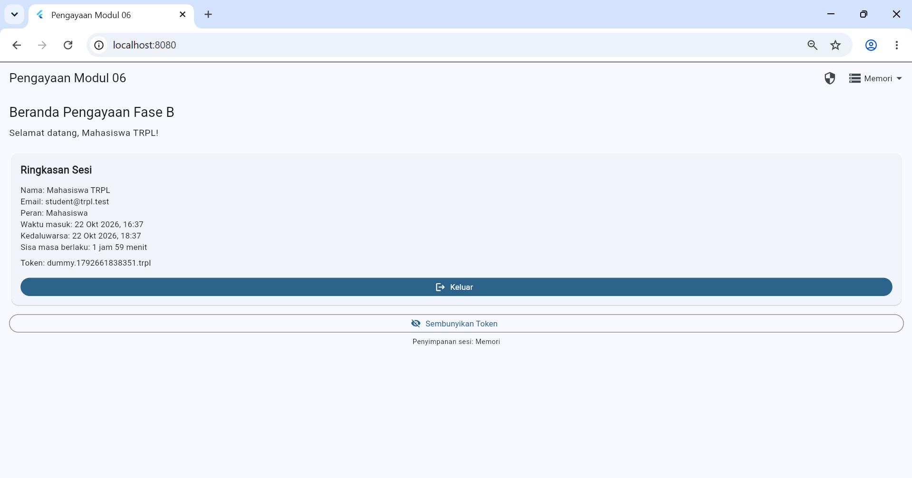
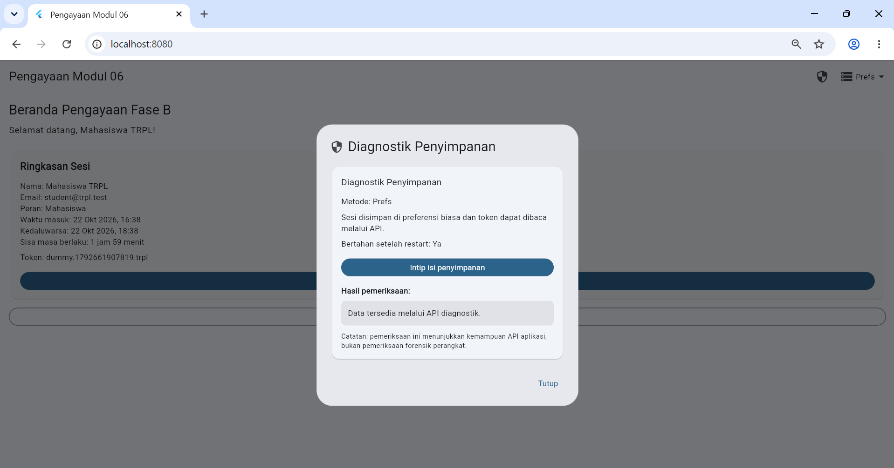
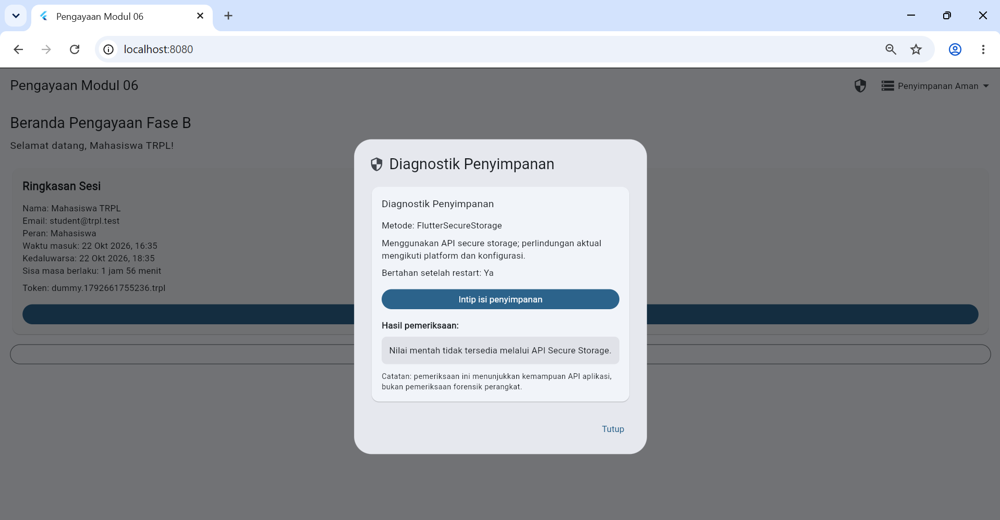

# Laporan Praktikum Modul 06: Login & Pengelolaan Sesi Aplikasi

- **Nama:** Elga Maulidia Akbari
- **NIM:** 362558302130
- **Kelas / Prodi:** 2E TRPL
- **Mata Kuliah:** Pemrograman Perangkat Bergerak (Semester 3)

---

## 1. Ringkasan Implementasi

Pada praktikum Modul 06 ini, saya membuat fitur login dan mencoba beberapa cara untuk menyimpan sesi pengguna di aplikasi Flutter.

Langkah-langkah yang saya kerjakan:

1. **Form Login dan Validasi (Fase A)**
   - Membuat tampilan login dengan tombol Isi Akun Demo.
   - Menambahkan validasi format email.
   - Menangani pesan kesalahan ketika akun terkunci atau server mengalami gangguan.
   - Menampilkan halaman beranda setelah login berhasil.

2. **Percobaan Penyimpanan Sesi (Fase B)**
   - **In-Memory:** Menyimpan sesi sementara di memori aplikasi.
   - **SharedPreferences (Prefs):** Menyimpan data sesi secara lokal.
   - **Penyimpanan Aman:** Mencoba penyimpanan sesi aman sesuai dukungan platform.
   - **Diagnostik Token:** Memeriksa status penyimpanan sesi dan token sesuai kemampuan aplikasi.

## 2. Bukti Tangkapan Layar (Running App)

### A. Alur Login dan Penanganan Error (Fase A)

| 1A. Form Login Kosong | 2A. Menggunakan Akun Demo |
|---|---|
|  |  |

| 3A. Format Email Salah | 4A. Pesan Akun Terkunci |
|---|---|
|  |  |

| 5A. Gangguan Server | 6A. Beranda Setelah Login |
|---|---|
|  |  |

### B. Percobaan Penyimpanan Sesi dan Diagnostik (Fase B)

#### 1. Penyimpanan Memori (In-Memory)

| 1B. Halaman Login Pengayaan | 2B. Beranda dengan Token Tersembunyi |
|---|---|
|  |  |

| 3B. Beranda dengan Token Ditampilkan | 4B. Diagnostik Penyimpanan Memori |
|---|---|
|  |  |

#### 2. Penyimpanan Preferences (SharedPreferences)

| 5B. Beranda Sesi Prefs | 6B. Diagnostik Penyimpanan Prefs |
|---|---|
|  |  |

#### 3. Penyimpanan Aman (Secure Storage)

| 7B. Beranda Sesi Aman | 8B. Diagnostik Secure Storage |
|---|---|
|  |  |

---

## 3. Kendala yang Dihadapi dan Solusinya

**Kendala 1: Kesalahan input dan gangguan server**

Solusi: Menambahkan validasi pada formulir login dan penanganan kesalahan agar pengguna mendapatkan informasi saat proses login gagal.

**Kendala 2: Sesi In-Memory hilang setelah aplikasi dimulai ulang**

Solusi: Mencoba SharedPreferences dan penyimpanan aman untuk mempelajari perbedaan penyimpanan sesi sementara dan persisten.

**Kendala 3: Token sensitif terlihat di layar**

Solusi: Mempelajari fitur sembunyikan dan tampilkan token jika didukung oleh implementasi aplikasi.

---

## 4. Jawaban Pertanyaan Refleksi

### 1. Apa pertanyaan baru yang muncul ketika sesi mulai disimpan secara persisten?

Ketika sesi disimpan, kita perlu memastikan apakah pengguna masih bisa login setelah aplikasi ditutup dan dibuka kembali. Kita juga perlu memeriksa apakah sesi yang sudah kedaluwarsa masih bisa digunakan.

### 2. Bagaimana tombol Back bisa menyebabkan kesimpulan yang salah tentang penyimpanan?

Tombol Back tidak selalu menutup aplikasi sepenuhnya. Jadi, kalau sesi masih ada setelah tombol Back ditekan, belum tentu sesi tersebut sudah tersimpan secara permanen.

### 3. Apakah pesan “Email atau kata sandi salah” merugikan pengguna?

Pesan ini memang tidak menjelaskan kesalahan secara detail. Namun, pesan tersebut lebih aman karena orang lain tidak bisa mengetahui apakah email yang dimasukkan sudah terdaftar atau belum.

### 4. Apa masalahnya jika SharedPreferences digunakan untuk menyimpan sesi?

SharedPreferences bisa digunakan untuk menyimpan data sederhana. Namun, untuk data penting seperti token login, Secure Storage lebih cocok karena memberikan perlindungan yang lebih baik.

### 5. Apakah token masih layak disimpan di perangkat yang sudah di-root atau dipantau?

Token masih bisa disimpan menggunakan Secure Storage karena lebih aman daripada penyimpanan biasa. Namun, jika perangkat sudah di-root atau dipantau, token tetap bisa berisiko diketahui orang lain. Karena itu, keamanan juga perlu diperhatikan dari sisi server.

---

## 5. Kesimpulan

Dari praktikum Modul 06, saya belajar cara login dan mengelola sesi pengguna di aplikasi Flutter. Saya juga belajar bahwa setiap metode penyimpanan memiliki kelebihan dan kekurangan. Oleh karena itu, metode penyimpanan harus dipilih sesuai kebutuhan agar data pengguna tetap aman.

# Praktikum-Testing Performa

## Modul 11 – Optimasi Performa Flutter

### Pendahuluan

Pada praktikum Modul 11 ini saya belajar tentang cara mengoptimalkan performa aplikasi Flutter, terutama ketika menampilkan data dalam jumlah banyak.
Pada latihan ini aplikasi menampilkan 1.000 data tugas. Saya juga mencoba fitur pencarian dan filter untuk melihat bagaimana aplikasi menampilkan tugas sesuai yang dicari.

### 1. Menjalankan Aplikasi

Pertama, saya mengatur aplikasi agar membuka halaman Modul 11. Setelah itu saya menjalankan aplikasi menggunakan perintah:

flutter pub get
flutter run

Setelah berhasil dijalankan, aplikasi menampilkan daftar tugas, kolom pencarian, dan pilihan filter status.

**Screenshot hasil menjalankan aplikasi (`flutter run`):**

|  | 

### 2. Mengenal Data dan Filter

Pada langkah ini saya mempelajari file `lib/modul_11/modul_11_app.dart` untuk mengetahui bagaimana data tugas dibuat dan ditampilkan.

Ada beberapa bagian yang saya pelajari:

- `_semuaTugas` digunakan untuk menyimpan 1.000 data tugas.
- `StatusTugas` digunakan untuk membedakan tugas yang masih aktif dan sudah selesai.
- `_hasil` digunakan untuk menyaring tugas berdasarkan pencarian dan filter.
- `_kueri` digunakan untuk menyimpan kata yang diketik pada kolom pencarian.

Dari bagian ini saya memahami bahwa data awal tetap tersimpan, sedangkan daftar yang ditampilkan akan berubah sesuai pencarian atau filter yang dipilih.

### 3. Mengenal ListView.builder

Selanjutnya saya mempelajari `ListView.builder` yang digunakan untuk menampilkan daftar tugas.
Dari kode tersebut saya memahami bahwa Flutter membuat widget daftar sesuai kebutuhan tampilan. Jadi, aplikasi tidak perlu membuat semua 1.000 kartu tugas sekaligus saat halaman pertama dibuka.
Di dalamnya juga terdapat `itemCount` untuk menentukan jumlah item dan `itemBuilder` untuk membuat tampilan setiap tugas.

### 4. Mencoba Pencarian dan Filter

Saya mencoba mencari tugas dengan mengetik `tugas praktikum 0002`. Hasilnya, aplikasi menampilkan 1 tugas yang sesuai dengan pencarian.
Setelah itu saya memilih filter **Selesai**. Hasilnya, aplikasi menampilkan 250 tugas yang sudah selesai dari total 1.000 tugas.
Dari percobaan ini saya jadi lebih memahami cara kerja pencarian dan filter pada daftar tugas.

### 5. Melakukan Pengujian

Setelah mencoba aplikasi, saya menjalankan pengujian menggunakan perintah:
flutter test test/modul_11_test.dart
Hasilnya, ketiga pengujian berhasil dijalankan dan muncul tulisan `All tests passed!`.
Pengujian ini memeriksa penggunaan `ListView.builder`, fitur pencarian, dan filter status tugas.

Screenshot hasil pengujian di terminal 
|  | 
|  | 

### Kesimpulan

Dari praktikum ini saya jadi lebih memahami cara menampilkan banyak data menggunakan `ListView.builder` di Flutter.
Saya juga belajar mencoba fitur pencarian dan filter pada daftar tugas. Saya memahami bahwa `ListView.builder` membantu membuat tampilan daftar lebih efisien karena widget dibuat sesuai kebutuhan tampilan, tetapi seluruh data tugas tetap tersimpan di aplikasi.