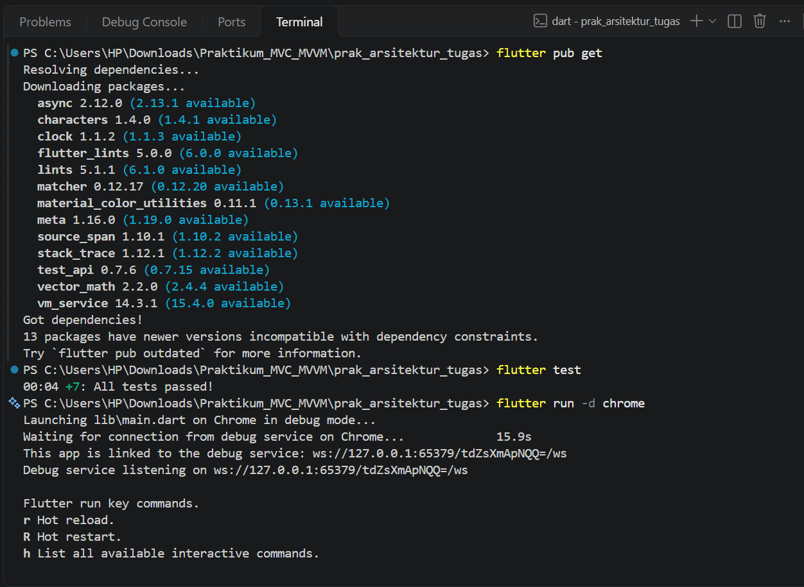
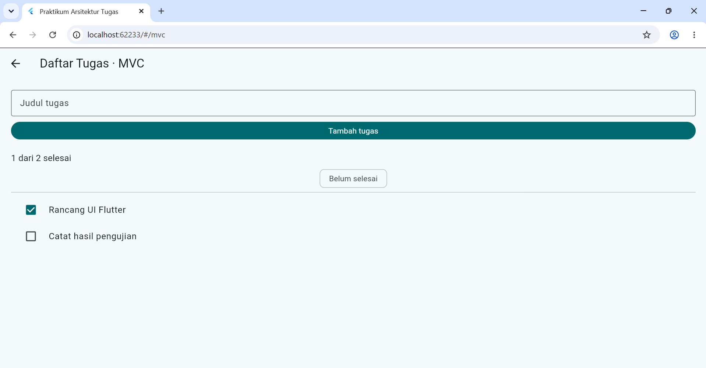
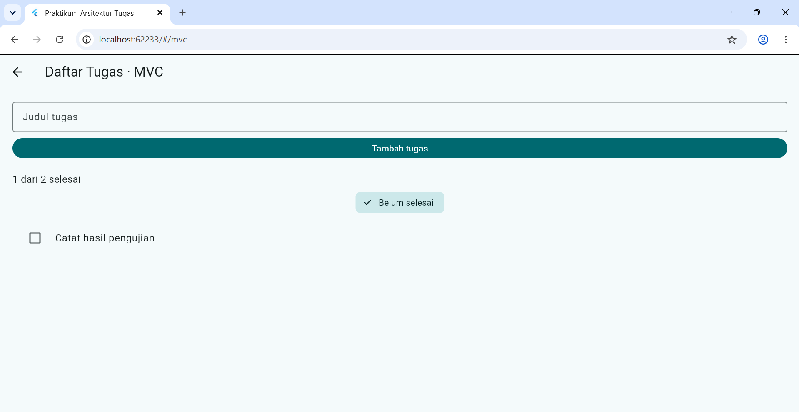
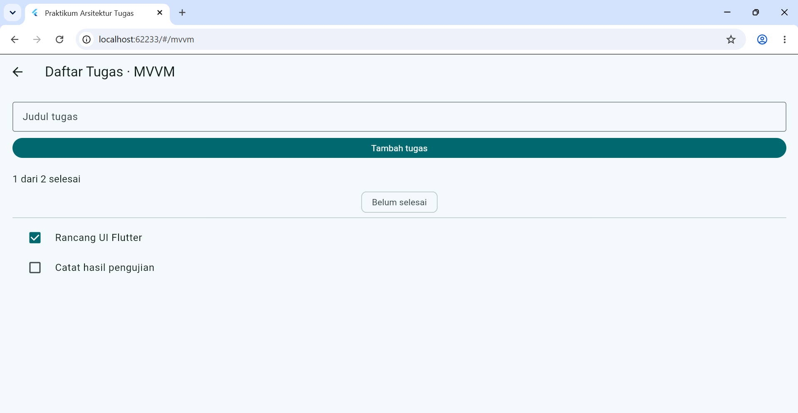
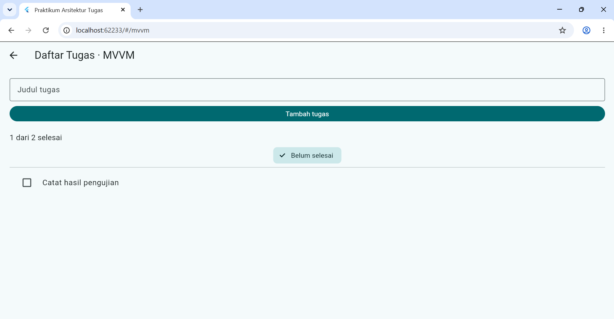
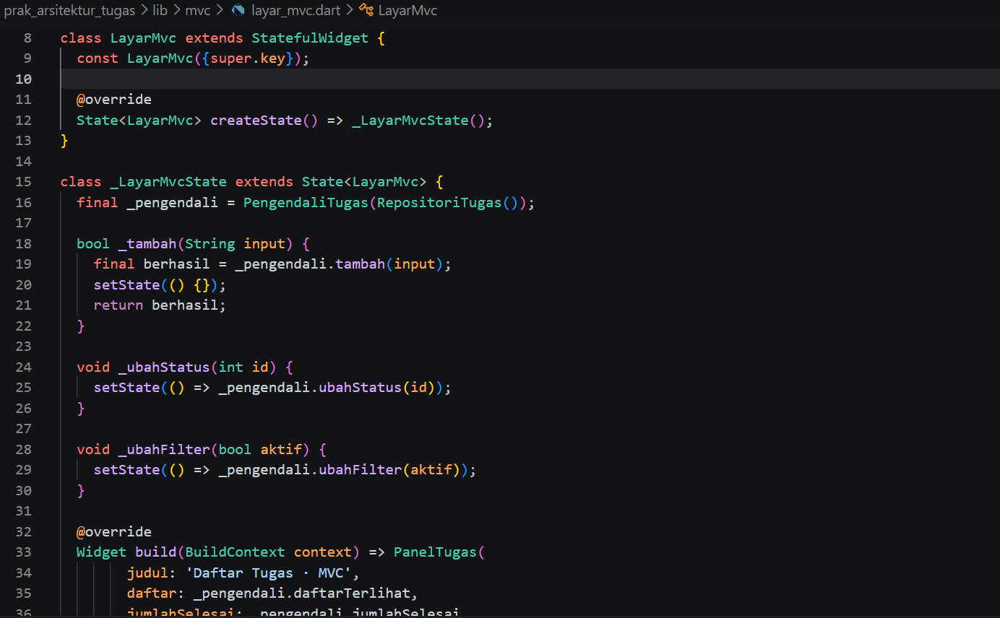
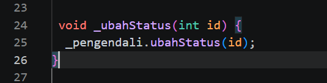
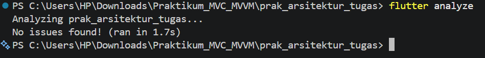
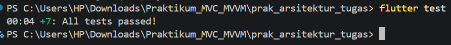

# Starter Praktikum Arsitektur Tugas

Jalankan dari folder yang berisi pubspec.yaml dengan Flutter 3.29.2.

    flutter pub get
    flutter test
    flutter run -d chrome

Starter memuat model, repository dalam memori, form, menu, dan smoke test. Kerjakan versi MVC, versi MVVM, dan test tambahan dengan mengikuti PDF praktikum. Layar awal kedua versi berisi petunjuk untuk mulai mengimplementasikan.

# Laporan Praktikum MVC dan MVVM

Nama: Elga Maulidia Akbari
NIM: 362558302130
Program Studi: TRPL
Mata Kuliah: Pemrograman Perangkat Bergerak

Praktikum ini membuat aplikasi Daftar Tugas menggunakan dua arsitektur, yaitu MVC dan MVVM. Aplikasi memiliki fitur tambah tugas, centang tugas selesai, melihat jumlah tugas selesai, dan filter tugas yang belum selesai.

# Persiapan Aplikasi
Sebelum menjalankan aplikasi, saya memasang package, menjalankan pengujian, dan membuka aplikasi melalui Chrome.

# Implementasi MVC
Pada MVC, proses pengelolaan tugas dilakukan oleh `PengendaliTugas`, sedangkan tampilan diatur melalui `LayarMvc`. Perubahan tampilan menggunakan `setState()`.

Filter tidak aktif

Filter aktif

# Implementasi MVVM
Pada MVVM, pengelolaan data dilakukan oleh `TugasViewModel`, sedangkan tampilan menggunakan `LayarMvvm`. Perubahan tampilan menggunakan `notifyListeners()` dan `ListenableBuilder`.

Filter tidak aktif

Filter aktif

# Perbandingan MVC dan MVVM
Menurut hasil praktikum, MVC dan MVVM memiliki cara kerja yang berbeda. Pada MVC, pengelolaan tugas dilakukan melalui Controller dan tampilan diperbarui menggunakan `setState()`. Sedangkan pada MVVM, pengelolaan tugas dilakukan melalui ViewModel dan tampilan diperbarui menggunakan `notifyListeners()`. Keduanya dapat menjalankan fitur aplikasi dengan baik.

# Percobaan setState()
Saya mencoba menghilangkan sementara `setState()` pada fungsi `_ubahStatus()`. Hasilnya, perubahan status tugas tidak langsung terlihat pada tampilan. Setelah `setState()` dikembalikan, tampilan dapat diperbarui kembali.

Kode awal

Kode setelah setState dihilangkan

# Hasil Pengujian
Pengujian dilakukan menggunakan `flutter test` dan `flutter analyze`.
Hasilnya, 7 pengujian berhasil dijalankan dan tidak ditemukan masalah pada kode.

Flutter Analyze

Flutter Test

